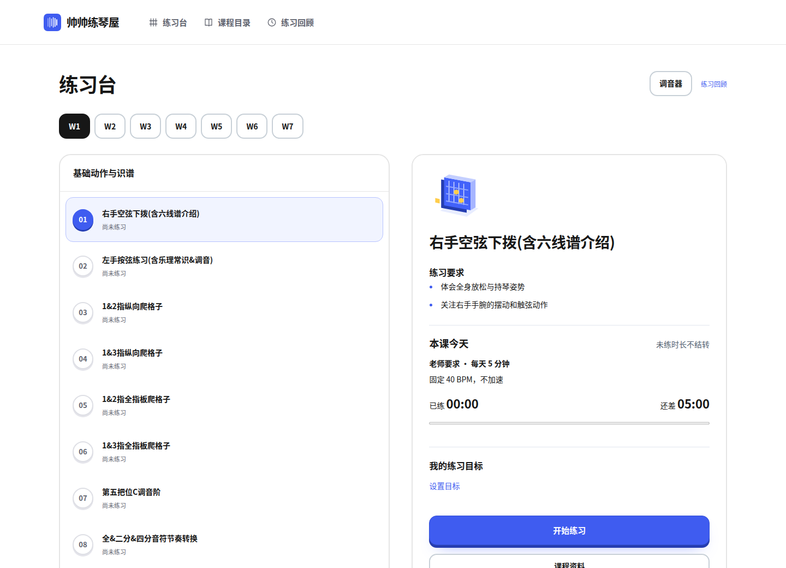
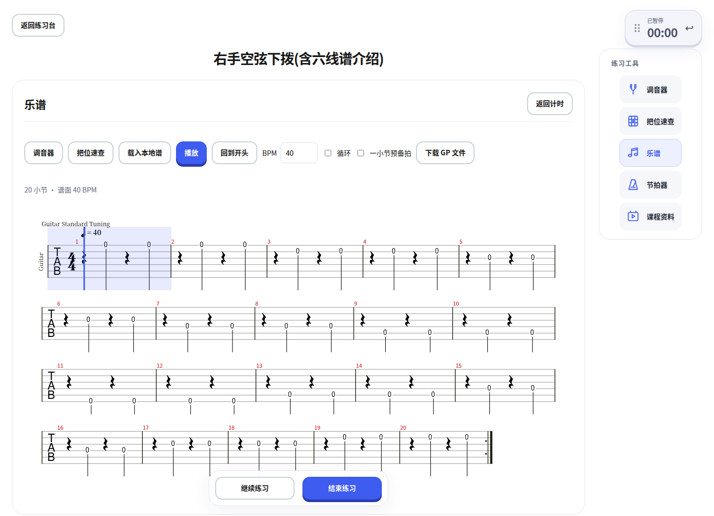
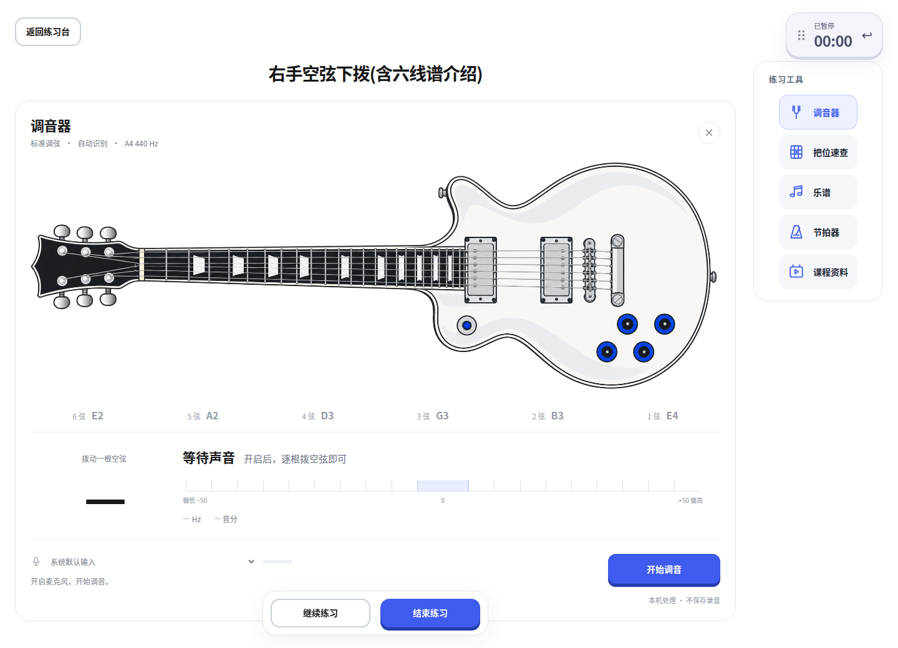

# 帅帅练琴屋

**跟着帅帅老师学电吉他，把每一课真正练起来。**

老师叮嘱练什么，打开就能看到；想跟着谱练，可以直接播放、调速、循环；习惯用 Guitar Pro，也能把乐谱下载带走。

免费开源 · 无需注册 · 练习记录保存在本机

**[🎸 在线开始练习](https://intsheep.github.io/EGuitarOmitrix/)　[下载客户端](https://github.com/intSheep/EGuitarOmitrix/releases/latest)　[观看老师原课](https://www.bilibili.com/video/BV1FT411Z7iu/)**



## 老师叮嘱的，练琴时也看得见

看完视频再拿起琴，有时会忘记：这一课要注意什么？练多久？节拍器该开多少？

练琴屋把原课中的练习要求整理到每一课旁边。选好课程，就能看到动作要点，以及有来源依据的时长和速度要求，还能直接打开对应的讲解、伴奏或示范视频。

例如，第一课「右手空弦下拨」提醒你放松身体、注意手腕摆动，并显示老师要求的**每天 5 分钟、固定 40 BPM、不加速**。这是这一课的要求，不是所有练习的统一标准。[查看原课对应片段](https://www.bilibili.com/video/BV1FT411Z7iu/?p=3&t=861)

- **老师要求与个人目标分开显示**：自己想练多久，不会覆盖老师的叮嘱。
- **今天练了多少、还差多少，一眼可见**：有明确每日时长要求时，展示当日进度。
- **没有说清的数字不乱补**：缺少依据的 BPM、次数和时长保持未知。

## 打开浏览器，就能看谱、听谱、跟着练

不必先安装桌面软件。进入练习，打开「乐谱」，就能使用已整理的可播放乐谱；也可以载入自己的 GP 或 MusicXML 文件。



- **边看边听**：播放乐谱，跟着播放位置练习。
- **调整播放速度、循环练习**：把暂时跟不上的地方慢下来，再多练几遍。
- **一小节预备拍**：给自己留出把手放回琴上的时间。
- **练习工具就在旁边**：乐谱、节拍器、调音器、把位速查和课程资料，在同一个练习页面里切换。

当前素材包含可播放乐谱和参考图示；仅有原谱画面的条目会显示图片，不会假装能够播放。播放速度是工具设置，不代表老师要求或你已经达到的稳定速度。

## 喜欢用 Guitar Pro？把谱带走

**网页里练，或者下载到自己熟悉的 Guitar Pro 里继续练，都可以。**

1. 在课程的练习页面打开 **乐谱**。
2. 选择需要的可播放乐谱，点击 **下载 GP 文件**。
3. 将下载的 `.gp` 文件手动打开到 Guitar Pro，按自己的习惯继续练习。

有相应资源时，也提供 **MusicXML 下载**和**原谱画面**查看。已有 GP 文件优先保留原文件；其他支持的结构化乐谱可通过播放器导出为 GP。

不是每张课程图片都能导出可播放乐谱，也不是所有文件都附带伴奏音频。整理和转换可能存在误差，请结合原课核对；目前不提供自动启动 Guitar Pro 的功能，也不承诺所有文件都已在原生 Guitar Pro 中逐一验收。

## 先调准琴，再安心练

标准六弦调音器直接放在练习工具里。开启麦克风、逐根拨动空弦，就能查看识别到的音高，以及偏高、偏低和松紧调整提示；支持选择可用的输入设备。



声音只在本机分析，不保存录音、不上传。打开调音器会暂停练习和播放，关闭或离开页面后停止采集；调音时间不会算进练习时长。

## 练过的留下来，下次接着练

练琴屋记录你实际投入的时间，也给你留出自己判断进步的空间。

| 练琴时的小需求 | 练琴屋怎么帮你 |
| --- | --- |
| 拿着琴，不想反复填表 | 开始、暂停、结束；自动记录前台练习时间。 |
| 去看一段老师的讲解 | 打开原视频，返回后单独确认看课时长，不混入练琴时间。 |
| 某个把位一时想不起来 | 随手打开 C 大调五种把位速查。 |
| 想知道这课最近练得怎么样 | 查看累计练习时长、历史记录，以及自己填写的稳定 BPM 和熟练度。 |
| 隔几天才回来练 | 继续原来的课程和记录，不因缺席制造“欠练任务”，也不会自动跳课。 |
| 想换浏览器或设备 | 导出备份，再在另一端导入；不需要账号。 |

完成计时不等于掌握技巧。稳定 BPM 和熟练度由你自评，可以留空，也可以回头修改。

## 从这套课程开始，感谢帅帅老师

感谢 **「帅帅是把电吉他」老师**带来的 **「零基础入门电吉他 · 7周自学计划」**。练琴屋的课程结构、教学素材和整理后的课程参考资料均来源于这套课程。

<a href="https://www.bilibili.com/video/BV1FT411Z7iu/">
  
</a>

**[回到 B 站原课程，跟着老师学，也支持老师的原创教学 →](https://www.bilibili.com/video/BV1FT411Z7iu/)**

本项目是独立制作的练习辅助工具，不是老师的官方产品，也不代表老师的认可或背书。教学内容以原课为准，课程素材归原作者所有。详见[素材来源与许可说明](COURSE_ATTRIBUTION.md)。

## 选一个顺手的入口

| 使用方式 | 适合你，如果…… |
| --- | --- |
| **[网页版](https://intsheep.github.io/EGuitarOmitrix/)** | 想点开就练。Windows、Mac 都可以先从浏览器开始，无需安装。 |
| **[Windows 客户端](https://github.com/intSheep/EGuitarOmitrix/releases/latest)** | 想使用独立窗口和内置课程资源；通过「帮助 → 检查更新」获取新版。 |
| **[Android 客户端](https://github.com/intSheep/EGuitarOmitrix/releases/latest)** | 想把手机或平板放在琴旁边使用；下载 APK 安装。 |

<details>
<summary>安装、更新和数据保存，需要知道的几件事</summary>

- 网页版加载网站和未缓存资源需要联网，尚未提供完整离线或 PWA 支持。练习结束后刷新页面，可使用新部署的版本。
- Windows 当前提供 x64 安装包，尚未签名，系统可能显示安全警告。早于 0.4.0 的版本需要先手动升级一次。
- Android 发布版使用固定签名，更新时下载新版 APK 并确认安装。旧调试版可能需要先导出备份、卸载，再安装并导入记录。
- macOS 原生包目前仅完成实验性构建，尚待正式签名、公证和真机验收，推荐先用网页版。
- 记录保存在当前浏览器或客户端中，没有云同步。浏览器和客户端的数据不自动互通，清理浏览器数据也可能清掉记录。
- 更换设备或升级前，请通过 **练习回顾 → 备份与管理** 导出备份。Windows 沿用 `%APPDATA%/EGuitarOmitrix` 数据目录。

</details>

## 一起把练琴屋变得更好用

遇到问题，或想到一个练琴时真正需要的小功能，欢迎[反馈](https://github.com/intSheep/EGuitarOmitrix/issues)。请附上设备、应用版本和复现步骤，不要上传个人备份或凭证。

<details>
<summary>开发者：本地启动与项目文档</summary>

使用 Node.js 24（见 `.nvmrc`）：

```sh
npm ci
npm run dev
```

打开终端输出的地址，通常为 `http://localhost:5173`。默认构建不包含课程资源；资源打包、测试和发布方法见下方文档。

[产品需求](docs/product/PRD.md) · [设计参考](docs/design/references-and-rationale.md) · [公开分发与验证](docs/engineering/public-distribution.md) · [构建与发布](docs/engineering/releases.md) · [课程资源](docs/engineering/course-resources.md) · [文档目录](docs/README.md) · [Agent 协作说明](AGENTS.md)

README 使用中文，其他项目文档目前主要使用英文。小范围改进可以直接提交聚焦的 PR，不必为每次修复另建 Issue。

</details>

项目自行编写的代码采用 [MIT 许可证](LICENSE)，不覆盖课程素材和第三方依赖的原有权利与许可。

<sub>界面截图来自实际运行的网页版，使用独立演示环境，未导入个人记录；计时仅为截图操作产生，不代表学习成果。课程封面由项目维护者提供，来源为上述原课。详见[图片来源](docs/images/README.md)。</sub>
