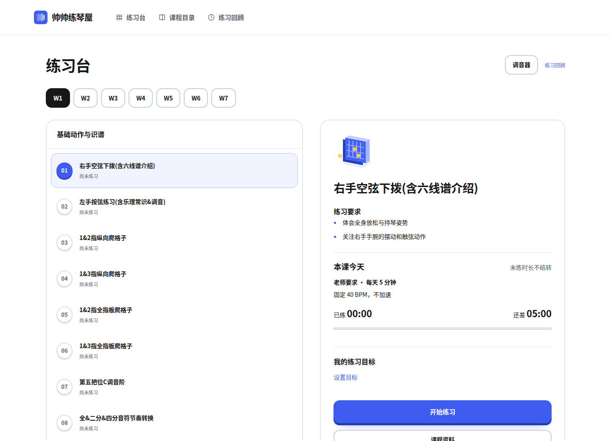
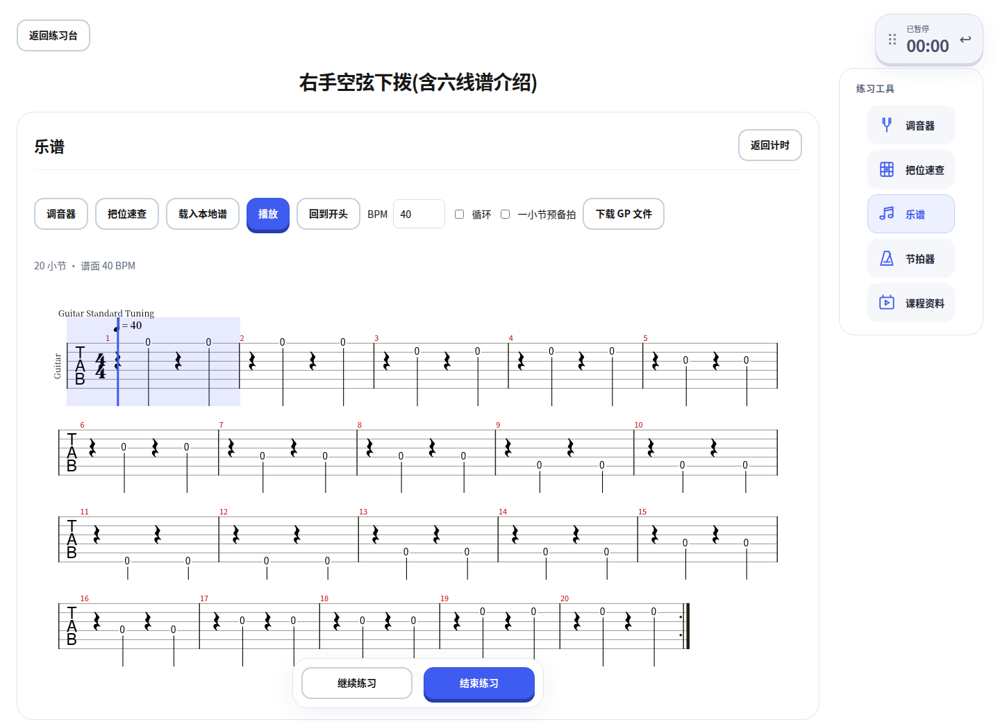
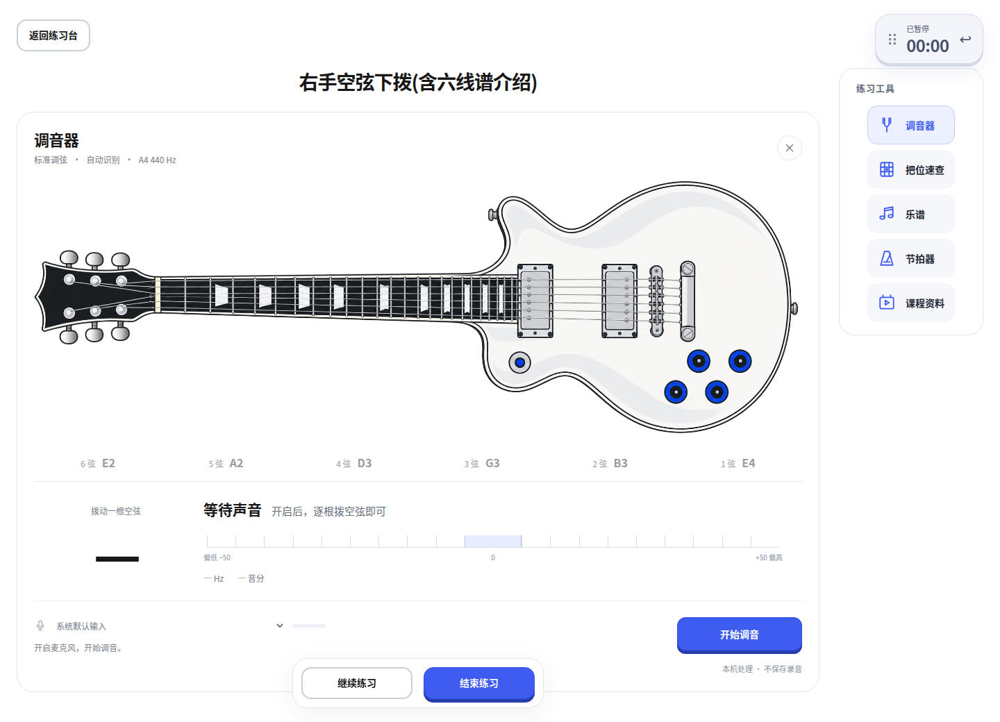

# 帅帅练琴屋 (EGuitarOmitrix)

> **跟着帅帅老师学电吉他，把每一课真正练起来。**
>
> 专为 B 站课程[《零基础入门电吉他 · 7周自学计划》（BV1FT411Z7iu）](https://www.bilibili.com/video/BV1FT411Z7iu/)打造的本地优先（Local-First）练琴工作台。老师叮嘱练什么，打开就能看到；内置在线可播放六线谱与一键唤起 **Guitar Pro**；配备调音器、节拍器、C 调把位速查与真实练习计时回顾。

[](https://intsheep.github.io/EGuitarOmitrix/)
[](https://github.com/intSheep/EGuitarOmitrix/releases/latest)
[](https://www.bilibili.com/video/BV1FT411Z7iu/)
[](LICENSE)

**[🎸 在线开始练习](https://intsheep.github.io/EGuitarOmitrix/)　·　[📦 下载桌面与移动端客户端](https://github.com/intSheep/EGuitarOmitrix/releases/latest)　·　[📺 观看 B 站老师原课](https://www.bilibili.com/video/BV1FT411Z7iu/)**



---

## 目录

- [核心特性](#核心特性)
- [平台支持与安装指南](#平台支持与安装指南)
- [功能详解](#功能详解)
  - [1. 忠于原课证据的练习要求](#1-忠于原课证据的练习要求)
  - [2. 在线交互乐谱与一键打开 Guitar Pro](#2-在线交互乐谱与一键打开-guitar-pro)
  - [3. 专注练琴工作台与练习工具箱](#3-专注练琴工作台与练习工具箱)
  - [4. 真实投入记录与跨设备备份](#4-真实投入记录与跨设备备份)
- [致谢与课程版权说明](#致谢与课程版权说明)
- [本地开发与构建](#本地开发与构建)

---

## 核心特性

- **🎯 原课要求精准溯源**：完整梳理 W1–W7 共 **140 个原课分P**、**66 项核心教学练习**与 **72 份经过时间戳核对的课后作业要求**。所有每日练习时长、固定/起始 BPM 均附带原课出处，未明确说明的数值绝不凭空编造。
- **🎼 内置曲谱 & 一键用 Guitar Pro 打开**：发行版内置 **114 份课程曲谱集**（含 96 份 `.gp`、97 份 `.musicxml` 及 149 张原谱画面）。支持应用内合成播放、BPM/百分比调速、循环与一小节预备拍；桌面端工具栏直接提供 **「用 Guitar Pro 打开」** 按钮一键唤起本机 Guitar Pro，网页端支持一键下载 `.gp` 文件。
- **🎸 五合一专注练习台**：在单一无干扰界面内无缝切换 **练习计时器**、**六弦麦克风调音器**、**C 大调五把位指板速查**、**乐谱浏览器**、**节拍器** 与 **原课视频材料**。切换工具不强行打断手动计时意图。
- **⏱️ 防误触计时与灵活结算**：前台真实计时（自动剔除睡眠或时钟异常间隔），**少于 1 分钟（60 秒）的试音或浏览在点击「结束练习」时自动退出且不计入记录**；满 1 分钟后支持 **「保存结果」**、**「返回练习」** 或 **「放弃本次练习」**，且看课时长与练琴时长严格分离。
- **🔒 零账号 · 纯本机隐私存储**：所有练习历史、熟练度自评、稳定 BPM 曲线与个人目标均保存在本地 `IndexedDB`，无需注册登录，支持带版本校验的 JSON 备份导出与无损合并导入。

---

## 平台支持与安装指南

| 平台 | 适用场景 | 获取与更新方式 |
| :--- | :--- | :--- |
| **[Web 网页版](https://intsheep.github.io/EGuitarOmitrix/)** | 无需安装，浏览器即开即用，支持载入本地 `.gp` / `.musicxml` 乐谱。 | 直接访问 GitHub Pages；刷新页面即可获取最新部署版本。 |
| **[macOS 客户端](https://github.com/intSheep/EGuitarOmitrix/releases/latest)** | Apple Silicon (`arm64`) / Intel (`x64`) 独立工作台，内置完整乐谱包，支持直接唤起 Guitar Pro 8。 | 下载 `.dmg` 拖入「应用程序」；点击左下角 **「检查更新」** 即可自动完成 SHA-256 校验与原地更新。 |
| **[Windows 客户端](https://github.com/intSheep/EGuitarOmitrix/releases/latest)** | Windows 10/11 (`x64`) 独立桌面客户端，内置完整乐谱包与 Guitar Pro 文件关联打开。 | 下载 `-setup.exe` 安装；支持通过左下角 **「检查更新」**（或菜单栏「帮助 → 检查更新」）在线升级。 |
| **[Android 客户端](https://github.com/intSheep/EGuitarOmitrix/releases/latest)** | 适合将手机或平板放在谱架/琴旁跟练，内置完整乐谱包与调音器。 | 下载 `.apk` 安装；使用固定发行签名，支持应用内检查更新或覆盖安装新版 APK。 |

<details>
<summary><strong>💡 macOS / Windows 首次安装与数据备份须知（点击展开）</strong></summary>

1. **macOS 未签名应用首次打开说明**：
   - 本项目作为免费开源个人工具，未购买 Apple 付费开发者公证签名。首次从 GitHub Release 下载打开若提示「无法验证开发者」，可在「访达 → 应用程序」中**按住 Control 键点击 `帅帅练琴屋.app` 选择「打开」**，或在终端执行：
     ```sh
     xattr -cr /Applications/帅帅练琴屋.app
     ```
   - 首次授权打开后，后续通过应用左下角 **「检查更新」** 升级时会自动在本地清除隔离属性并完成替换，无需再次手动处理。
2. **Windows 安全提示说明**：
   - Windows 安装包同样未附加商业代码签名，首次运行 SmartScreen 提示时可选择「更多信息 → 仍要运行」。数据保存在 `%APPDATA%/EGuitarOmitrix`。
3. **跨端数据迁移**：
   - 浏览器、桌面客户端与手机端的数据各自独立保存在本机，无云端同步。升级或更换设备前，可通过 **「练习回顾 → 备份与管理 → 导出备份」** 保存 `eguitar-practice.json`。

</details>

---

## 功能详解

### 1. 忠于原课证据的练习要求

看完视频再拿起琴，经常会忘记：这一课动作要点是什么？每天练多久？节拍器开多少？

练琴屋将原课字幕与视频尾卡中的作业要求整理在每一课详情页中。例如第一课「右手空弦下拨」明确展示老师要求的 **每天 5 分钟、固定 40 BPM、不加速**，并提供一键跳转到 [原课对应时间点（P003 · 14:21）](https://www.bilibili.com/video/BV1FT411Z7iu/?p=3&t=861)。

- **老师处方与个人目标分离**：你可以设置自己的每次练习时长或目标 BPM，但绝不会篡改老师的原始要求。
- **今日剂量进度条**：当课程有明确每日分钟数要求时，自动汇总当日已完成时长。
- **严守证据边界**：原课未指明具体 BPM、遍数或时长时保持未知，不作主观臆测。

### 2. 在线交互乐谱与一键打开 Guitar Pro

进入任意课程练习后打开 **「乐谱」**，即可直接查看并播放当前练习曲谱，或载入本机的 `.gp` / `.gp3`–`.gpx` / `.musicxml` 文件。



- **高频直达 Guitar Pro**：工具栏直接提供 **「用 Guitar Pro 打开」**（桌面客户端直接唤起本机 Guitar Pro 8 打开当前曲谱；网页端直接下载 `.gp` 文件），无需在二级菜单中翻找。
- **边看边听、调速循环**：支持跟谱高亮播放、调整 BPM（或内嵌音频百分比速度）与段落循环。
- **「更多 ⋯」辅助选项**：收纳「回到开头」、「一小节预备拍」、「载入本地谱」、「下载 MusicXML」与「原谱画面」对照查看。

> **说明**：仅有原谱画面的条目会诚实展示原谱图片，不伪造可播放音符。播放速度仅作为跟练辅助，不代表你已达到的稳定速度。

### 3. 专注练琴工作台与练习工具箱

在专注练习页（`#focus`）中，顶部工具栏可在五个高频工具间即时切换，底部始终保留当前练习时间与「暂停练习 / 结束练习」主控栏，右上角提供「← 返回计时」与「菜单」：



- **标准六弦调音器**：实时识别 `E2–E4` 空弦音高、音分偏差（`±50 cents`）与松紧调整方向，支持切换音频输入设备。声音仅在本机内存分析，不录音、不上传；关闭工具或切换窗口时自动释放麦克风。
- **C 大调把位速查**：内置标准调弦下 C 大调第 1–5 把位指板图，支持一键切换「显示唱名 / 显示音名」并高亮主音 `C`。
- **内置节拍器**：遵循课程固定速度或禁止节拍器规则，记录真实开启节拍器跟练的时长分布。
- **原课视频材料**：直接打开对应的教学、伴奏或示范视频；看课时长单独确认，不混入练琴计时。

### 4. 真实投入记录与跨设备备份

| 练琴场景 | 练琴屋的处理方式 |
| :--- | :--- |
| **随手点开看谱/调音（< 1 分钟）** | 点击「结束练习」时自动退出且**不计入练习记录**，避免产生几秒钟的无效噪音记录。 |
| **练满 1 分钟但本次不想保存** | 在结算页提供 **「保存结果」**、**「返回练习」**、**「放弃本次练习」** 三个完整选项。 |
| **记录进步轨迹** | 支持选填本次实际稳定 BPM（`1–400`）与熟练度自评（`还不熟` / `能慢速完成` / `基本顺畅` / `已掌握` / `可以复习`），生成近 7 天柱状图与 84 天热力图。 |
| **隔了一周没练** | 随时接着上次的课程与速度继续，不制造焦虑的“断签惩罚”或“欠练账单”。 |

---

## 致谢与课程版权说明

感谢 **「帅帅是把电吉他」老师**在 B 站创作分享的 **《零基础入门电吉他 · 7周自学计划》**。练琴屋的课程目录、教学要求摘要与整理后的参考曲谱均源于这套课程。

<a href="https://www.bilibili.com/video/BV1FT411Z7iu/">
  
</a>

**[👉 前往 B 站观看原课程，支持帅帅老师的原创教学](https://www.bilibili.com/video/BV1FT411Z7iu/)**

> 本项目为独立开发的开源练琴辅助工具，非老师官方出品，亦不代表老师的官方背书。一切教学细节请以原课视频为准，课程音视频与谱面素材权利归原作者所有。详见 [素材来源与许可说明 (COURSE_ATTRIBUTION.md)](COURSE_ATTRIBUTION.md)。

---

## 本地开发与构建

本项目使用 **Node.js >= 24**（见 [.nvmrc](.nvmrc)），前端基于 **React 19 + TypeScript + Vite + Tailwind CSS**，桌面端基于 **Electron**，移动端基于 **Capacitor Android**。

```sh
# 1. 安装依赖（含 desktop 子包）
npm ci

# 2. 启动本地开发服务器（默认 http://localhost:5173）
npm run dev

# 3. 运行类型检查、代码规范与单元测试
npm run typecheck
npm run lint
npm run test:ui
npm test

# 4. 构建前端产物并运行 Playwright 端到端测试
npm run build
npm run test:web
```

### 客户端打包命令

```sh
# 下载并校验课程乐谱资源包（需已登录 gh CLI 或可访问 GitHub Releases）
node scripts/download-course-resources.mjs

# 打包 macOS 客户端（生成 arm64 & x64 的 .dmg 与 .zip）
EGUITAR_COURSE_PACK=private/course-resources-2026.10.20.1.zip npm run package:mac

# 打包 Windows 客户端（生成 x64 NSIS 安装包）
EGUITAR_COURSE_PACK=private/course-resources-2026.10.20.1.zip npm run package:windows

# 打包 Android 客户端
EGUITAR_COURSE_PACK=private/course-resources-2026.10.20.1.zip npm run package:android
```

### 项目文档导航

- [产品需求文档 (PRD)](docs/product/PRD.md)
- [视觉与交互设计参考](docs/design/references-and-rationale.md)
- [工程校验与不变量指南 (AGENT_GUIDE)](docs/engineering/AGENT_GUIDE.md)
- [公开分发策略](docs/engineering/public-distribution.md) · [版本发布流程](docs/engineering/releases.md) · [课程资源包规范](docs/engineering/course-resources.md)
- [架构决策记录 (ADR 0001–0009)](docs/README.md) · [协作规则 (AGENTS.md)](AGENTS.md)

---

## 开源许可

本项目独立编写的源代码采用 [MIT License](LICENSE) 开源，不覆盖原课程素材及第三方依赖（如 AlphaTab 等）各自的原有权利与许可证。

<sub>文档配图采集自独立演示环境，不包含任何个人练习隐私数据；详见 <a href="docs/images/README.md">图片来源说明</a>。</sub>
