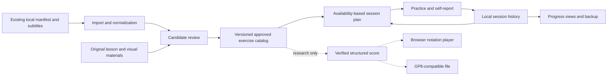

# Product Requirements Document — EGuitarOmitrix

- Version: 0.5
- Date: 2026-10-18, Asia/Shanghai
- Status: Immersive timed practice and effort review authorized; automatic planning remains deferred
- Owner: intSheep
- Delivery: Private repository; GitHub Issues + Milestones + pull requests
- Design: Stitch
- Documentation: English for human and Agent audiences

## 1. Product intent

Help a working adult continue an electric-guitar course even when practice is limited to a few sessions per week. The product answers three questions: **What should I practice now? What exactly did the teacher ask for? Am I improving?**

A course stage must not expire because a calendar week passed. The learner should be able to return after a break, choose the time available, and continue with a small, clear set of exercises.

The owner authorized an initial implementation on 2026-10-18: exercise browsing and direct navigation to the corresponding Bilibili episodes. This revision plans the core tracker, implements that bounded entry point, and defers notation conversion/playback. The owner later clarified that Duolingo is a reference for selected style and motion, not its mascot, copy, game structure, or layout.

## 2. User problem and operating context

- Assignments are spoken across introductions, demonstrations, and lesson endings. Rewatching to recover them creates friction.
- The teacher's schedule can exceed the learner's available time. Missing days causes an accumulating sense of backlog.
- Minutes practiced do not reveal whether rhythm, tone, coordination, or a particular passage improved.
- Demonstrations, backing tracks, older revisions, and teaching episodes appear in the same playlist.
- The learner reports having Guitar Pro 8 on a Windows computer and wants to investigate practicing either inside the platform or through that application.

Primary user: one adult learning electric guitar from the linked Chinese course. Desktop Windows is the primary planning and research context. A responsive phone layout is desirable beside the instrument; cross-device synchronization is not part of the first release.

## 3. Evidence baseline

The referenced conversation identified [Bilibili course BV1FT411Z7iu](https://www.bilibili.com/video/BV1FT411Z7iu/). Local materials were checked again on 2026-10-18:

| Item | Observed evidence |
| --- | --- |
| Playlist entries | 140, including teaching, introductions, backing tracks, demonstrations, follow-along material, and older versions |
| Entries with AI subtitles | 81, with 8,989 cues; JSON, SRT, and TXT files present |
| Entries without independent subtitles | 59; title-based classification includes 8 teaching exercises and 1 outro |
| Saved videos | 60 MP4 files present with report-matching byte sizes; 59 missing-subtitle entries plus P121 |
| Course organization | W1–W7, plus preparation and outlook; 16 titles marked as older versions |
| Structured notation files | Owner currently does not know of separate score files and only identifies notation in the videos; the inspected packages are not a verified score library |

The audit validates local inventory and subtitle structure, not the correctness of every transcription or current public download access. A fresh web fetch returned HTTP 412. Historical authenticated retrieval succeeded, but reliable unattended crawling is not proven.

Representative findings:

- P003, W1-EX1: AI subtitle evidence at 861.06–894.42 seconds describes five minutes daily, relaxed technique, metronome 40, and explicitly no speeding up.
- P070, W4-EX8: 828.51–849.80 seconds describes thirty minutes daily, keeping time, reading the score, and starting at 40. The closing passage does not state a numeric final BPM; it must remain unknown until another source establishes it.
- P002, W1-INTRO: 22.72–29.26 seconds allows choosing a mix of technique and song work when two hours daily is unavailable. Cross-lesson instructions matter.

See [source assessment](source-assessment.md) for confidence and coverage limits.

## 4. Outcomes and success measures

These are pilot targets, not achieved measurements:

| Outcome | Measurement and initial target |
| --- | --- |
| Start without rewatching everything | Owner finds a useful next exercise within 30 seconds in 4 of 5 observed trials |
| Low-friction logging | Typical completion log takes at most 30 seconds after a session |
| Trustworthy assignments | Every published numeric prescription has a source span or is explicitly labeled learner-authored; zero unsupported numbers in the reviewed pilot |
| Recover from a break | After a simulated seven-day absence, the same learning progress remains and a smaller session can be chosen immediately |
| Visible progress | The owner can identify the last practice, a remaining difficulty, and comparable clean-tempo history for an exercise |
| Durable records | Backup/restore preserves all reviewed tasks and session records in the acceptance dataset |

Collect pilot feedback manually and locally. Third-party analytics are outside the MVP.

## 5. Scope and release boundary

### Core tracker plan

1. Import existing course metadata and subtitle files; keep missing content visible.
2. Extract editable assignment candidates and verify them against timestamped evidence.
3. Browse reviewed exercises by course stage and skill category.
4. Build a practice session around available time and a flexible weekly intention.
5. Record actual duration, optional repetitions, tempo, self-assessed quality, and next-step notes.
6. Show exercise history and weekly activity without punitive streak mechanics.
7. Preserve local data and provide versioned export/restore.

### First implemented slice

- A task-focused practice workspace with W1–W7 stage selection, a persistent desktop exercise-detail pane, and compact-screen detail dialogs.
- A searchable catalog of 140 source entries, including 66 current teaching exercises; support media and old revisions remain distinguishable.
- Exact outbound Bilibili links using BV ID, observed page, and CID. The source-navigation cursor stays independent from the practice database; opening a video is not practice progress.
- A neutral, adult-oriented visual system with brief selection/press feedback. No mascot, slogan, serpentine path, XP, or fabricated learner history.

### Assignment and manual logging slice (2026-10-18)

The owner accepted the Brilliant style and authorized organizing all lesson assignments, recording actual time and playing level, and resuming next time. This slice adds:

- 72 lesson summaries: 64 text-reviewed AI-subtitle candidates and 8 visually reviewed video closing cards; current/legacy identities remain separate. All have source timestamps/checksums, with uncertain numeric values left unknown.
- Manual actual minutes, self-reported level, optional BPM, notes and next focus; editable history and reversible deletion.
- IndexedDB persistence, versioned export, previewed non-overwriting merge, stale-edit detection and visible save failures.
- Resume from the latest actual practice, independent of the latest watched video. Explicit source URLs retain precedence.

These records are single-exercise attempts, not automatically grouped sessions. The broader timer, flexible auto-planner, weekly analytics, audio verification/review editor, offline shell, and score playback remain later work. See ADR 0002 for exact persistence semantics.

### Later candidates

- Optional authenticated subtitle refresh, with explicit missing-track, expired-access, and retry states.
- Assisted transcription/OCR for missing speech or visual teaching material, followed by human review.
- Optional reminders, richer audio notes, and multi-device sync.

### Deferred playback work

- In-platform notation rendering, synthesized playback, BPM adjustment, and passage looping.
- Structured score creation/conversion and export for Guitar Pro 8.
- Launching a local GP8 score from the web product, including whether a helper is justified.

### Non-goals for the first release

Automatic correctness grading from guitar audio; full music transcription from performances; a full notation editor; automatic extraction of reliable tablature from arbitrary video; a replacement for the teacher; a public course redistribution service; social rankings; billing; mandatory accounts; a promise to finish W1–W7 in seven calendar weeks.

## 6. User journeys

### A. Recover the actual assignment

Import the existing course package → inspect lesson coverage → open an extracted candidate beside subtitle context → correct transcription and missing values → approve the exercise → add it to the practice queue.

If the relevant exercise has no subtitle, show a source link and an empty manual assignment form. Do not silently mark it as having no homework.

### B. Practice after work

Open Today → choose 5, 15, 30 minutes, or a custom budget → review a small proposed mix → adjust or start → pause as needed → save actual work and a quality note → see what to revisit next time.

The original teacher prescription remains visible. A five-minute adaptation of a thirty-minute exercise is legitimate practice but does not claim that the original daily prescription was fulfilled.

### C. Return after a gap

Open Today after a missed week → see the last exercise and next-step note → optionally select a short review → continue the current course stage. No automatic reset, doubled quota, or forced catch-up calendar is created.

### D. Evaluate improvement

Open an exercise → compare sessions with the same passage, tempo basis, and quality criteria → see attempted BPM separately from self-reported clean BPM → choose continue, review later, or move on. Playback or elapsed time alone never proves mastery.

### E. Explore a future play-along route

If a verified machine-readable score exists, the future product could offer a browser player or an export for GP8. If only a picture, PDF, or video frame exists, it must first go through conversion and musical verification. This journey is research only; see [playback research](../research/practice-playback.md).

## 7. Functional requirements

### Content and evidence

| ID | Priority | Requirement | Acceptance criterion |
| --- | --- | --- | --- |
| FR-001 | P0 | Import a course manifest plus Bilibili subtitle JSON, SRT, or TXT with user-selected lesson mapping. Prefer timed JSON/SRT. | The known package produces 140 distinct source entries and 81 subtitle-bearing entries; TXT-only sources are explicitly untimed. Repeating the same import creates no duplicates. |
| FR-002 | P0 | Classify entries as teaching, intro/outro, demo, backing, follow-along, or other; distinguish old versions. | User can correct inferred type and link multiple media entries to one exercise. An old revision cannot silently replace an approved current task. |
| FR-003 | P0 | Extract assignment candidates: action, practice method, duration, frequency, repetitions, tempo rules, quality criteria, and relevant materials. | An unspecified value stays null. Every instructor-derived field links to evidence; source wording and normalized meaning remain distinguishable. |
| FR-004 | P0 | Provide review, correction, approval, and rejection before a candidate becomes recommended work. | Low-confidence numbers, conflicting statements, and visual dependencies are visible. Approval records who reviewed and when; later changes create a revision. |
| FR-005 | P0 | Support source navigation and manual completion. | The learner can open the original episode and see the timestamp. A failed deep link falls back to the episode URL plus displayed seek time. Manual content is labeled as such. |
| FR-006 | P0 | Keep stage-wide guidance and relationships with exercises. | P002 guidance can inform the plan without being copied into each lesson as a newly invented prescription. Conflicting lesson/stage instructions require review. |

### Planning and practice

| ID | Priority | Requirement | Acceptance criterion |
| --- | --- | --- | --- |
| FR-007 | P0 | Set a weekly session intention and per-session available minutes; allow overrides. | Changing from three sessions to one changes suggestions, not past records or course position. Multiple sessions in one day are supported. |
| FR-008 | P0 | Recommend a bounded session from approved tasks, recent difficulties, and review needs. | Scheduled durations never exceed the chosen budget. Teacher dose and adapted allocation appear separately. The learner can replace or skip a suggestion. |
| FR-009 | P0 | Keep course stages independent from calendar weeks and allow manual progression. | Seven days of absence create no overdue exercise copies, reset, or automatic promotion. Skipped work stays identifiable for later review. |
| FR-010 | P0 | Run a foreground session timer with start, pause, resume and automatic recording on finish; no manual duration form. | Paused time is excluded. Refresh or sleep produces a recoverable draft and an elapsed-time review instead of silently counting the gap as practice. |
| FR-011 | P0 | Log each practiced exercise with actual seconds, optional repetition count/unit, attempted tempo, self-reported clean tempo, quality checks, and notes. | A partial session saves; unknown quantities are not zero. Invalid negatives and impossible date ranges are rejected. Editable logs update aggregates without duplicate counting. |
| FR-012 | P0 | Track exercise state separately from individual session completion. | States include not started, learning, review, and self-reported ready; each can be revisited. Finishing one timer cannot automatically mark an exercise mastered. |

### Progress and ownership

| ID | Priority | Requirement | Acceptance criterion |
| --- | --- | --- | --- |
| FR-013 | P0 | Show weekly sessions, minutes, practiced days, exercise coverage, and per-exercise history. | Multiple sessions on one day count as multiple sessions and one practiced day. Watching time and preview-only playback are not added to practice time. |
| FR-014 | P0 | Compare tempo and quality only in meaningful context. | Same exercise version, passage, meter/subdivision, and criteria are required for a trend; incompatible versions are shown separately. Missing BPM has no interpolated improvement. |
| FR-015 | P0 | Store reviewed tasks and practice records locally; export and restore a versioned backup. | After the app has been initialized, imported tasks and logging work offline. Restore validates before committing and preserves the previous workspace on failure. Media files are excluded and listed for relinking. |
| FR-016 | P0 | Preserve user edits and history across content refresh and deletion. | Re-import offers a reviewable diff. Retired exercises remain resolvable from old logs. Deleting a log offers undo and updates history. |

### First-slice navigation requirement

| ID | Priority | Requirement | Acceptance criterion |
| --- | --- | --- | --- |
| FR-017 | P0 | Provide an immediately usable exercise/source navigator while the broader tracker is developed. | All 140 entries remain available, 66 current teaching exercises appear in open stage lists, desktop uses list-detail, compact screens stack the selected exercise above the list, every outbound link resolves to the catalog page/CID, and no view is counted as practice. |

### Research requirements, without implementation authorization

| ID | Priority | Research question | Deliverable |
| --- | --- | --- | --- |
| R-001 | Research | Can the platform display guitar notation and provide BPM control, looping, and play-along? | Primary-source comparison, technical limits, required score inputs, and a future validation plan. |
| R-002 | Research | Can existing course material become playable GP8-compatible scores? | Input-format decision tree; distinguish native scores, MusicXML/MIDI, PDFs, tabs, numbered notation, and audio. No unsupported promise of automatic conversion. |
| R-003 | Research | Can a Windows user click through to GP8? | Separate download-and-open from a registered app-launch bridge; document association requirements, unknowns, and manual logging boundaries. |

## 8. Assignment and progress semantics

An **episode** is a source video entry. An **exercise** is a practice task, potentially supported by several episodes or score variants. A **course stage** is W1, W2, etc. A **session** is one occasion of actual practice and contains one or more exercise attempts.

Store three independent layers:

1. **Instructor prescription:** cited instructions, including a duration basis such as per day versus per repetition. Daily minutes do not imply a known number of sessions per day.
2. **Learner plan:** chosen time allocation and intended focus for this occasion, explicitly adapted when it differs.
3. **Actual practice:** observed duration and learner-entered outcomes. A personal intention and an original teacher dose have separate completion indicators.

Tempo fields distinguish start BPM, target BPM, fixed BPM, do-not-increase rules, and unknown values. Repetitions carry a unit such as passes, bars, or sets. Do not treat video playback rate as BPM, or automatically increase speed on an exercise whose instruction forbids it.

Quality is self-report in the MVP: e.g. needs work / sometimes consistent / consistently controlled, with an optional note. The app must not claim to have heard or validated the playing.

## 9. Planning rules

Use transparent rules rather than an opaque recommendation system in the first release:

1. Start with the last unfinished approved exercise and any learner-pinned focus.
2. Add review from earlier practice when there is room; explain why each task is suggested.
3. Favor a mix of technique and musical application when relevant approved tasks exist. Do not invent a song exercise to satisfy a quota.
4. Cap the total at the available time. If a task cannot sensibly fit, offer another task or a labeled partial segment; never misrepresent a shortened dose as the full prescription.
5. Leave the queue intact when a session is missed. Regenerate suggestions from the next actual availability.
6. Recommend review after a break without automatic demotion or a punitive backlog.

No numerical spacing algorithm, default mastery threshold, or course-completion deadline is asserted as teaching evidence. These are future configurable product choices requiring pilot feedback.

## 10. Proposed system boundaries

Proposed MVP storage is a browser-local structured store, with export/restore and no mandatory backend account. The storage engine and frontend stack remain an engineering decision. User-selected imports are copied into app data; original Downloads files remain untouched. Video assets remain external references, with explicit relinking where browser access expires.

Assignment extraction may be assisted offline or through an explicitly configured model provider. The first usable catalog may be prepared and reviewed outside the app and imported as structured data. The review workflow and practice loop must work without a live model call. No secret API key is bundled into frontend code, and sending course text to an external provider must be an explicit import choice.

The learner owns practice records. Content revisions own source evidence and task definitions. Future synchronization must resolve these independently; replacing the course must not replace practice history. Rollback uses validated workspace backups and previous content versions.

## 11. UX and nonfunctional requirements

- NFR-001: Target current Windows Chrome/Edge and responsive layouts at 390 px and desktop widths; exact tested versions are recorded when implementation exists.
- NFR-002: The workspace has one start action. The focus page records elapsed practice automatically; self-report after completion is optional. Source videos share one material picker and launch action. Avoid promotional headlines and decorative game navigation.
- NFR-003: Keyboard access, visible focus, text labels for statuses, and readable notation-independent task text are required. Color alone must not convey review or progress state.
- NFR-004: A failed save, unavailable storage, or quota error must remain visible and offer a safe retry/export; no success toast before persistence succeeds.
- NFR-005: Schema upgrades validate and retain a recoverable prior snapshot. Future schema versions fail safely on older clients.
- NFR-006: Charts use the browser local calendar, with a rolling seven-day view and 84-day activity calendar. Sessions crossing midnight retain actual timestamps and a documented local-date allocation rule.
- NFR-007: No raw course media, credentials, or learner history in Git, issue attachments, or public design artifacts. Demo screens use labeled synthetic records.
- NFR-008: Private repository and local-first behavior are product constraints; they do not imply cloud sync, cross-device access, or a security audit has been delivered.

## 12. Acceptance scenarios

| Scenario | Required result |
| --- | --- |
| Import the known course twice | 140 source entries; no duplicate exercises, transcripts, or logs |
| Import P003 evidence | Candidate records daily five minutes and fixed 40 BPM with no speed-up; approval is still required |
| Import P070 closing evidence | Candidate records daily thirty minutes and start 40; numeric target stays null |
| Open P017 without subtitles | Missing-content state, original lesson link, and manual-review path; no fabricated task |
| Two sessions on Tuesday, none for seven days | Two sessions, one practiced day; no reset or backlog duplication |
| Choose five minutes for a thirty-minute prescription | Clearly labeled partial practice; original dose unchanged |
| Resume after browser sleep | Review an interrupted draft; no unattended gap counted as playing |
| Replace an old course revision | Explicit comparison and selection; prior logs still reference their original version |
| Backup and restore | Same tasks, versions, sessions, and settings; malformed backup leaves existing data intact |
| Ask for a playable score from subtitles alone | Explain missing notation; do not generate authoritative fingering or rhythm from spoken text |

## 13. Risks and decisions still open

| Question or risk | Current treatment | Decision point |
| --- | --- | --- |
| AI subtitle errors in music terms and numbers | Timestamped evidence and human review | Content pilot |
| Eight teaching exercises lack subtitles | Manual completion first; optional transcription later | Content pilot |
| Visual-only notation, fingering, or rhythm | Mark visual dependency; do not infer full notation from text | Score inventory |
| Old and current versions share exercise labels | Preserve source identity and revision relations | Catalog review |
| Automatic scraping may need login and may be blocked | Existing local package is sufficient for the initial path | Optional importer investigation |
| Browser storage loss or per-device isolation | Visible local-only status and backup/restore | Storage ADR |
| Score source files may not exist | Request available score format when work reaches conversion | Research follow-up |
| GP8 is reported installed but not verified in this task | No launch or machine modification during research | Separately authorized integration test |
| User's exact practice budget and current course position | Editable onboarding choices; no assumed fixed schedule | Pilot onboarding |

## 14. Delivery gate

The owner authorized FR-017 navigation and subsequently the assignment/manual-record/resume slice. This implements bounded portions of FR-003/004/009/011–016; The owner subsequently authorized FR-010 foreground timing, an actual-time review dashboard and a simple metronome in issue #12. Full source review, automatic planning and offline delivery remain later work. Notation conversion, online playback, and native launching are deferred and require a later implementation decision. No implementation estimate is assigned to unvalidated score preparation.

Design choices must follow the [reference and functional rationale](../design/references-and-rationale.md): borrow restrained visual feedback from learning products while using an information architecture suited to repeated guitar practice.

See [roadmap](roadmap.md), [Stitch brief](../design/stitch-brief.md), and [Agent guide](../engineering/AGENT_GUIDE.md).

## 15. Focus slice acceptance (v0.4)

The latest owner request supersedes earlier manual logging and disclosure-based layouts. Use one start action, automatic observed time, pause/resume, a recoverable paused draft and transactional finish. Hide global navigation during focus. Pause on video launch, hidden pages and interruptions. One material dialog contains the video selector and launch control. Use source-backed task summaries without extraction-status badges; unknown numeric targets remain unknown. Do not infer mastery from time or metronome settings. Show real accumulated time, exercise history, daily bars and an 84-day activity calendar. Retain older manual logs and backups. See [ADR 0003](../decisions/0003-focus-practice.md) and [Stitch decisions](../design/focus-practice.md).

## 16. Owner-authorized score pilot (v0.5)

The owner now authorizes video-frame extraction, reviewed MusicXML/GP preparation and browser score playback. FR-018: preserve timestamped source evidence, page overlap decisions and unknowns when preparing scores; never infer unseen notation. FR-019: display local structured scores in the immersive page with playback, tempo/loop controls and GP downloads. Initial acceptance covers one static and one scrolling source, not the whole course. Native launch helpers, microphone grading and automatic six-line-tab recognition remain outside scope. See [actual coverage and validation](../research/video-score-preparation.md).

### FR-019 extension — Embedded audio preparation (2026-10-18)

Owner-authorized local MusicXML/score-model → audio processing → explicit sync points → audio-embedded GP pipeline. Keep candidate and reviewed alignment distinct. Include source hashes, trim parameters and synchronization evidence. Test GP reimport and browser playback independently from GP8 musical acceptance. Native GP8 inspection is authorized; no system protocol/file-association change is needed. The initial tooling rejects repeats/jumps, keeps uncertain timing out of accepted lesson defaults, and provides a documented GP8 acceptance gate. Current real artifact is a demonstration-audio draft; independent backing alignment and native acceptance remain open in #22.

FR-019 preparation clarification (2026-10-18): when a source supplies numbered notation without string/fret instructions, preserve its pitches, octaves and rhythm as staff notation rather than inventing source fingering. Added count-in measures and candidate audio anchors are preparation metadata, distinct from the instructor's notation and the owner's listening acceptance.

### Quiet practice guidance extension (2026-10-18, issue #31)

The owner authorizes a bounded FR-010–016 loop: optional learner-authored minutes per session, weekly session intention and target BPM; automatically observed foreground practice time and metronome-use duration by BPM; an end screen with optional self-reported stable BPM and learning/steady/mastered choice; and direct continuation of the same lesson on return. Finishing a session does not infer mastery or automatically advance the course. No practice-time prompts, microphone judgment, scheduled notifications or automatic speed increases are included.

The finish screen can return to the same draft or save it once. Unknown stable BPM and proficiency remain null. A failed save preserves the draft and confirmation inputs for retry. Learners can revise results in history. Resume uses the same assignment version and preserves teacher fixed-speed/no-metronome constraints. Learner target BPM is never interpreted as actual achievement. Weekly intention is counted from Monday in the browser's local calendar, independently of instructor per-day requirements.

### Source-backed daily progress (2026-10-18, issue #33)

Connect the current assignment's explicit, evidence-linked daily minutes and tempo wording to a daily progress section. Keep fixed, starting, target, per-piece and percentage tempos distinct; unknown values remain unknown. A numeric quote does not override an explicitly null reviewed field. No target BPM is invented and no time completion implies mastery.

Show today's observed time and remaining prescribed duration for the selected lesson/version, including the active draft once. Use actual interval overlap with the browser-local calendar day; split cross-midnight sessions. Deleted records and other lessons/versions do not count. Unknown daily duration shows actual time without a denominator or remaining-time claim. Personal per-session goals remain separate. Missed days never create debt or additional tasks; the display derives only the current date and updates across midnight without rewriting history.
