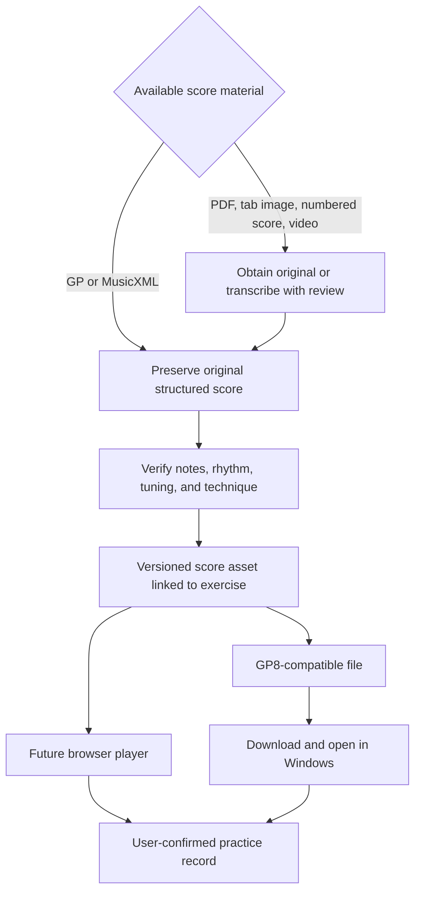

# Practice playback: browser versus Guitar Pro 8

- Research date: 2026-10-18, Asia/Shanghai
- Scope: R-001, R-002, R-003
- Status: Documentation research only; no implementation, software installation, app launch, file conversion, protocol registration, or playback testing

## Recommendation

Use **one verified score asset with two possible playback destinations**. If the teacher supplies Guitar Pro files, preserve those originals and evaluate both browser playback and GP8. If only PDF, screenshots, or video notation exists, score preparation and musical correction are a separate workstream.

For an initial Windows workflow, exporting/downloading a compatible score and opening it in the learner's existing GP8 installation is the smaller integration surface. In-platform playback is technically promising with alphaTab and would offer a more cohesive practice experience. This ranking is an engineering inference from documented capabilities, not measured implementation effort or a successful integration test.

Here, "practice online" means displaying the score, playing a guide/backing part, and letting the learner play a real guitar alongside it. Microphone recognition, note-accuracy scoring, low-latency effects, and virtual-guitar keyboard input are separate features and are not included.

The owner clarified that separate score files are not currently known and only notation in the videos has been identified. Treat video-visible notation as the working input assumption; do not assume that a GP file already exists.

## 1. The input format decides the work

| Available input | Route to a playable score | Confidence and limitation |
| --- | --- | --- |
| Teacher's `.gp`, `.gpx`, `.gp5`, or other supported GP file | Open in GP8; evaluate import into the browser renderer | Best starting point; verify tuning, rhythm, articulations, and supported features |
| MusicXML/MXL | Import into GP8 or a compatible notation engine; correct guitar-specific details | Structured notation, but source quality and importer support still matter |
| MIDI | Import into GP8 and assign instrument/tuning/notation; correct rhythm and fingering | Pitch/timing alone do not uniquely establish the teacher's strings, frets, or techniques |
| ASCII tab | GP8 has an import route | Text tab may omit rhythmic precision and expressive information |
| Printed standard-staff PDF/image | Optical music recognition may produce MusicXML, then manual correction | Separate recognition workflow; not a direct GP8 or alphaTab PDF import |
| Six-line tab image, numbered notation, or video-frame score | Obtain the original or transcribe and verify notation manually; investigate specialist recognition only with real samples | Do not assume a generic OMR engine supports these formats |
| Spoken subtitles | Recover assignments and constraints | Not enough information to reconstruct a full authoritative score |
| Audio/video performance alone | Separate transcription research | No automatic accurate conversion promised, especially for polyphony and guitar technique |

GP8's official support lists GP-family, MIDI, ASCII, MusicXML, PowerTab, and TablEdit input formats. Its import documentation describes structured-score imports. [Supported formats](https://support.guitar-pro.com/hc/en-us/articles/204846962-GP8-Where-can-I-find-Guitar-Pro-tabs), [import guide](https://www.guitar-pro.com/docs/gp8/import-export/import).

**GP8 does not directly import PDF and automatically turn it into editable tablature or standard notation.** This is stated explicitly by Arobas Music; the cited support article is in French. [Official PDF limitation](https://support.guitar-pro.com/hc/fr/articles/19237871925021-GP8-Peut-on-convertir-un-fichier-PDF-en-fichier-Guitar-Pro-dans-Guitar-Pro-8).

Audiveris documents scanned printed western notation to MusicXML with manual correction. Its tablature handling detects and excludes tab regions rather than interpreting their notes. It should therefore not be presented as an automatic six-line-guitar-tab converter. Numbered notation is also not established as supported by the reviewed material. [Audiveris scope](https://github.com/Audiveris/audiveris/blob/master/docs/_pages/handbook.md), [tablature behavior](https://audiveris.github.io/audiveris/_pages/guides/specific/tablature/).

## 2. Route A: practice within the platform

### Candidate: alphaTab

The project's official site documents GP 3–8 and MusicXML input, guitar tablature and other notation display, synthesized audio, a moving playback cursor, and track controls. It lists MPL-2.0 as its code license. These make it a suitable candidate for a future browser play-along spike; compatibility with this course's actual scores is still untested. [Official overview](https://alphatab.net/).

| Desired control | Documented capability | Product work still needed |
| --- | --- | --- |
| Read and follow notation | Score rendering, cursor, and track selection | Accessible responsive practice layout and source-to-exercise mapping |
| Slower/faster playback | `playbackSpeed`, where 1.0 is original speed and 0.5 is half | Display source BPM and actual practice BPM correctly |
| Repeat a passage | `playbackRange` in MIDI ticks and `isLooping` | Bar selection, persistence, and reliable start/end behavior |
| Count-in and pulse | `countInVolume`; metronome API exposed by the player | Audible defaults, mute controls, and loop/count-in interaction testing |
| Export a compatible score | `Gp7Exporter` outputs a `.gp` file | Validate that GP8 opens it and the course's techniques survive round trip |

Sources: [playback speed](https://alphatab.net/docs/reference/api/playbackspeed/), [playback range](https://alphatab.net/docs/reference/api/playbackrange/), [looping](https://alphatab.net/docs/reference/api/islooping/), [count-in](https://alphatab.net/docs/reference/api/countinvolume/), [API controls](https://docs.alphatab.net/docs/reference/types/alphatabapibase/), [score export](https://docs.alphatab.net/docs/guides/exporter).

### BPM is not always a single multiplier

For a constant-tempo score, a future UI can map desired BPM to a relative factor: target BPM / original BPM. For example, 60 / 120 = 0.5. This is a calculation based on the documented relative-speed API, not a claim of a native fixed-BPM override.

If a score changes from 80 to 120 BPM, a 0.5 factor produces 40 then 60 BPM. It does not produce a constant 40 BPM. A fixed-tempo mode requires a deliberate tempo-map strategy and separate validation. Preserve the original score and teacher instructions; never silently rewrite either to meet a practice setting.

The source and log must retain the beat unit, subdivision, passage, and score version. A learner practicing eighth notes at a 40 BPM pulse cannot be compared indiscriminately with a different subdivision or a doubled metronome convention.

### Audio and offline constraints

Synthesized notation playback and slowing the original backing recording are different paths. alphaTab's media-sync guide describes synchronizing external recordings, including embedded GP8 audio, but notes mode limitations and that changing audio pitch is unsupported by that integration. Original Bilibili streams must not be assumed embeddable or synchronizable. [Media synchronization guide](https://alphatab.net/docs/guides/audio-video-sync/).

A future player must test browser audio start after user interaction, background suspension, loop timing, SoundFont load failures, and offline asset availability. SoundFont distribution terms must be checked separately from the library's code license before bundling. These are future verification items; this research did not install or package a player.

## 3. Route B: use Windows Guitar Pro 8

GP8 documents relative speed, fixed-tempo mode, and progressive speed training. Fixed tempo ignores score tempo automation and is unavailable when an audio track is present. For ordinary practice, selecting a passage and enabling loop supports focused repetition. [Speed settings](https://www.guitar-pro.com/docs/gp8/audio/playback/speed), [loop playback](https://www.guitar-pro.com/docs/gp8/audio/playback/play).

The metronome and countdown are built in, with configurable countdown and visual metronome options. The platform would not need to reproduce those features for this route. [Tempo and metronome](https://www.guitar-pro.com/docs/gp8/audio/playback/tempo-metronome).

### What "click to open" can mean

| Path | Proposed experience | Evidence boundary |
| --- | --- | --- |
| Download/open | Select a score in the platform → download `.gp` → open the downloaded file with GP8 through the user's file association | Lowest integration burden; still needs a real Windows acceptance test |
| Local attachment reminder | Show the known filename and instructions to open it; allow reselecting a moved file | Browser-readable attachments do not imply permission to launch an executable |
| Dedicated desktop wrapper or helper | A registered URI handler or local companion resolves an app-owned score ID and opens the file in GP8 | Additional installed component and security review; research only |

GP8 documents opening supported score files and file associations. Windows documents launching apps through registered URI/file handlers and user-selected defaults. That supports the general integration pattern, but does **not** prove that GP8 exposes a public `guitarpro://` protocol or remote tempo-control API. No such protocol or control API was established by this research. [GP8 file management](https://www.guitar-pro.com/docs/gp8/basics/first-steps/file-management), [Windows URI activation](https://learn.microsoft.com/en-us/windows/apps/develop/launch/launch-default-app), [Windows default programs](https://learn.microsoft.com/en-us/windows/win32/shell/default-programs).

A normal web download should be described honestly as "Download for Guitar Pro". Do not promise a universal one-click launch, change file associations, or invent a `file://` shortcut as an established integration. A future helper would need an allowlisted score mapping, argument-safe launching, user initiation, and no arbitrary path or shell-command execution. It is not part of this request.

### Tracking remains independent

Opening GP8 is not evidence that a learner practiced. GP8 playback duration, repetition count, selected BPM, and achieved quality will not automatically return to the tracker without a separately supported integration.

For a first file-based route, the learner logs time, tempo, and outcome manually after practicing. If a future tracker timer stays open while GP8 has focus, background time needs an explicit review because app focus cannot distinguish playing from interruption. File launch must not increment practice totals or mark a task completed.

## 4. Recommended shared score record

This is a research design proposal, not an implemented schema:

- Stable asset ID, exercise ID/version, provenance, checksum, format, and revision.
- Original file retained separately from corrected or exported derivatives.
- Tuning, capo, meter, tempo map, track, bar range, and target technique where known.
- Review status: unavailable / awaiting conversion / awaiting musical review / verified for a named player and version.
- Links to original video/score evidence and any transcription corrections.
- Player-specific practice settings separate from the score's original tempo and the instructor's prescription.

## 5. Comparison for this project

| Dimension | Browser playback candidate | GP8 file route |
| --- | --- | --- |
| Practice interface | Unified lesson, score, and log | Tracker and local application |
| Existing strengths | Render/play/loop APIs available | Mature editing and training controls already available in the reported installation |
| Required input | Verified machine-readable notation | Verified supported score file |
| Main project work | UI, audio lifecycle, score compatibility, persistence, offline assets | Score preparation, download/open workflow, manual record handoff |
| Automatic progress evidence | Player events help record settings, not correctness of real guitar playing | No proven return channel; manual confirmation |
| Mobile use | Potentially useful; device testing required | This proposal targets the user's Windows setup |
| Original recording sync | Separate capability and test scope | GP8 supports audio-related practice, with fixed-tempo limitations |
| Current recommendation | Later candidate if staying in one interface matters | First candidate for validating a real score with minimal app integration |

## 6. Future validation plan — not executed

Only after the user authorizes a trial:

1. Inventory the teacher's actual score attachments and identify their formats. Do not search unrelated personal folders or assume scores are available.
2. Select three representative exercises: a simple fixed-tempo drill, a rhythm/notation exercise, and a song passage with guitar-specific effects. Use authorized source files.
3. If only images exist, manually prepare a small reference score and record correction effort. Treat generic tab recognition as unproven.
4. Open the same verified assets in GP8 and, if approved, a small alphaTab spike. Compare notes, string/fret choices, durations, rests/ties, repeats, tuning/capo, and relevant articulations.
5. Test slower/faster constant-tempo playback, a changing-tempo passage, selected-bar looping, count-in, and original-score preservation. Test audio-track limitations separately.
6. Exercise download/open with the actual Windows association and no helper. Record prompts and clicks; verify file-not-found and missing-GP8 behavior.
7. Re-import any exported `.gp` into GP8 and compare against the reference. Reject silent musical corruption even when the file opens.
8. Confirm that preview/launch events do not create practice logs; logging stays user-confirmed.

A future decision should record exact application/library versions, successful and failed examples, fidelity issues, and measured preparation effort. No effort estimate or conversion accuracy percentage is claimed now.

## 7. Open questions

- Does the course include `.gp`, `.gpx`, `.gp5`, MusicXML, PDF, or image downloads?
- Are its numbered notation and tablature available independently of video frames?
- Is the main goal synthesized score playback, original backing-track playback, or both?
- Would download-and-open be sufficient, or is a separately installed desktop helper worth maintaining?
- Which exact GP8 build is installed, and which file associations are already configured?

These questions do not block the task-tracking PRD. They block promises about real course conversion and seamless native launch.
